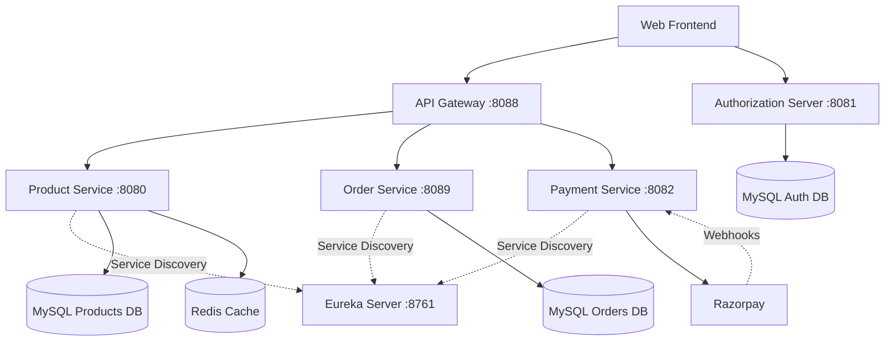
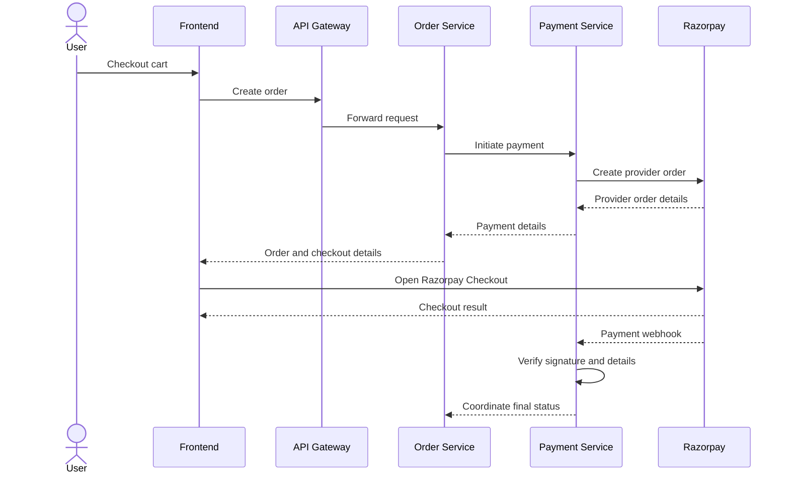

# E-Commerce Microservices Platform

A backend-focused e-commerce application built using Java and Spring Boot. The project follows a microservices architecture, with separate services for product management, authentication, order processing, and payment integration.

The application demonstrates real-world backend development concepts such as REST APIs, service discovery, API Gateway routing, OAuth 2.0 authentication, JWT-based authorization, Redis caching, database migrations, payment webhooks, and payment reconciliation.

## Features

- Product listing, product details, and pagination.
- Role-based product management for users and administrators.
- OAuth 2.0 and OpenID Connect authentication.
- JWT-based authentication for protected APIs.
- Microservices communication using service discovery.
- Centralized API routing through Spring Cloud Gateway.
- Redis caching for product data.
- Order creation and order-status management.
- Razorpay payment integration.
- Payment webhook handling and signature verification.
- Payment status reconciliation.
- Database schema management using Flyway.
- Correlation IDs for request tracing and debugging.
- Unit and controller-level testing using JUnit, Mockito, and MockMvc where implemented.
- AWS deployment work for the Product Service.

## Architecture

The application consists of independently runnable Spring Boot services.



### Why Microservices?

The application separates business responsibilities into individual services. This makes the codebase easier to maintain and allows services to be developed, configured, and run independently.

- **Separation of concerns:** Product, authentication, order, and payment logic are maintained separately.
- **Service discovery:** Eureka allows services to discover registered service instances.
- **Centralized routing:** The API Gateway provides a single entry point for frontend API requests.
- **Independent persistence:** Data is organized around service responsibilities.
- **Scalability:** Individual services can be scaled independently when the deployment infrastructure supports it.

## Services and Ports

| Service | Port | Responsibility |
|---|---:|---|
| Product Service | 8080 | Product APIs, database operations, and caching |
| Authorization Server | 8081 | OAuth 2.0 / OpenID Connect login and token issuance |
| Payment Service | 8082 | Razorpay integration and payment lifecycle handling |
| Order Service | 8089 | Order creation, status tracking, and reconciliation |
| Eureka Server | 8761 | Service registration and discovery |
| API Gateway | 8088 | Routing requests to backend services |

These ports refer to the local development configuration.

### 1. Product Service

The Product Service manages the product catalog and exposes REST APIs for retrieving and managing products.

Key responsibilities:

- Retrieve product listings and individual product details.
- Support product creation, updates, and deletion according to authorization rules.
- Persist product information in MySQL.
- Cache product-list and individual-product lookups using Redis.
- Manage database schema changes using Flyway.
- Enforce role-based access control for product operations.

The current implementation uses cache names such as `PRODUCTS` and `PRODUCTS:{id}`.

Hibernate is configured to validate the database schema rather than automatically create or modify it.

### 2. Authorization Server

The Authorization Server handles authentication and token issuance using Spring Authorization Server and Spring Security.

Key responsibilities:

- Implement OAuth 2.0 Authorization Code flow with PKCE.
- Support OpenID Connect login functionality.
- Issue JWT access tokens.
- Persist authorization data using JDBC-backed authorization storage.
- Support role-based authorization for users and administrators.

The application includes users with roles such as `ROLE_USER` and `ROLE_ADMIN`.

### 3. Order Service

The Order Service manages order creation and order status.

Key responsibilities:

- Create orders from cart items containing product IDs and quantities.
- Persist order information in the `orders` database.
- Track order and payment status.
- Coordinate with the payment flow.
- Support reconciliation when payment confirmation is delayed or requires verification.
- Register with Eureka as `ORDER-SERVICE`.

### 4. Payment Service

The Payment Service integrates the application with Razorpay.

Key responsibilities:

- Initiate payment flows and create provider-side payment orders.
- Return payment information required by the frontend checkout.
- Process Razorpay webhook events.
- Handle successful/captured and failed payment events.
- Verify webhook signatures and relevant payment details.
- Update payment status according to the application's status-transition rules.
- Support reconciliation when payment status remains pending.

The backend does not rely solely on the browser's payment success or failure redirect to determine the final payment status.

### 5. Eureka Server

Eureka acts as the service registry.

Services register their application names with Eureka, allowing other components to discover service instances without relying entirely on hardcoded instance addresses.

Where configured, load-balanced service calls can use the registered service name to resolve an available instance.

### 6. API Gateway

Spring Cloud Gateway provides a single entry point for frontend API requests.

Responsibilities include:

- Routing requests to the appropriate backend service.
- Using configured service names and Gateway routes.
- Reducing the need for the frontend to maintain individual backend URLs.
- Supporting a centralized entry point for the microservices architecture.

## Technology Stack

| Technology | Purpose |
|---|---|
| Java | Backend application development |
| Spring Boot | Building independent backend services |
| Spring Web | REST API development |
| Spring Security | Authentication and authorization |
| Spring Authorization Server | OAuth 2.0 authorization and token issuance |
| OAuth 2.0 / OpenID Connect | Secure login and authorization |
| JWT | Bearer tokens for protected APIs |
| Spring Cloud Gateway | API routing |
| Netflix Eureka | Service discovery |
| MySQL | Persistent relational data |
| Redis | Product-data caching |
| Flyway | Database schema migrations |
| Razorpay | Payment processing integration |
| Webhooks | Payment event notifications |
| Maven | Dependency management and builds |
| JUnit | Automated testing |
| Mockito | Mocking dependencies in tests |
| MockMvc | Testing Spring MVC endpoints |
| AWS Elastic Beanstalk | Product Service deployment work |
| Amazon Route 53 | DNS configuration |
| HTML, CSS, JavaScript | Static frontend |

Java 21 is the target version for the Order Service. Check the individual service build files for their configured Java versions.

## Authentication and Authorization

The browser login flow uses OAuth 2.0 Authorization Code with PKCE.

The high-level flow is:

1. The frontend generates a PKCE verifier and challenge.
2. The browser redirects to the Authorization Server.
3. The user authenticates.
4. The Authorization Server redirects back with an authorization code.
5. The frontend exchanges the code and verifier for tokens.
6. The frontend sends the access token when calling protected APIs.

Example authorization header:

```http
Authorization: Bearer <access-token>
```

### Role-Based Access

The Product Service's configured security rules distinguish between normal users and administrators.

- `GET /products/**`: requires an authorized user role.
- Product-management operations: restricted to administrators.
- Other endpoints: protected according to the configured security rules.

The frontend login flow and backend security configuration must use matching redirect URIs, token issuers, and role/authority mappings.

## Order and Payment Workflow

The application integrates order processing with Razorpay checkout.



The diagram illustrates the logical flow; exact service-call ordering depends on the current implementation.

### Payment Status and Reconciliation

- An order can remain in `PAYMENT_PENDING` while confirmation is outstanding.
- Verified successful payment events can move the relevant records toward a successful state.
- Failed payment events are handled according to the application's status-transition rules.
- The reconciliation endpoint is `GET /orders/{orderId}/reconcile`.
- Recovery/reconciliation is configured for orders that remain in `CREATED` or `PAYMENT_PENDING` states, with a five-minute interval in the current implementation.

Webhook signature verification helps ensure that payment notifications are authentic. Reconciliation provides a way to resolve cases where confirmation is delayed or a webhook is missed.

## Frontend

The project includes a static HTML, CSS, and JavaScript frontend.

The UI supports:

- Home page and product listing.
- Product details.
- Cart management.
- OAuth login.
- Order creation.
- Razorpay checkout.
- Payment success and failure views.
- Product-list pagination.

The local frontend communicates with the API Gateway at:

```text
http://localhost:8088
```

The frontend has used an IntelliJ preview URL during development. This URL is specific to the local setup and is not a production hosting address.

## Local Development Setup

### Prerequisites

Install or configure:

- JDK compatible with each service.
- Git.
- MySQL.
- Redis.
- Maven Wrapper included in each service project.
- Razorpay test-mode credentials for payment testing.

### 1. Clone the Repository

Replace the placeholders with your actual GitHub repository details.

```bash
git clone <repository-url>
cd <repository-directory>
```

### 2. Prepare the Databases

Create the databases expected by the service configurations:

- `products`
- `orders`
- `oauth2_auth_server`

Confirm that MySQL is running and that the configured database user has the required permissions.

Flyway manages schema migrations where configured.

### 3. Start Redis

Start Redis locally at the configured address:

```text
localhost:6379
```

The Product Service uses Redis for caching.

### 4. Start the Services

A useful local startup order is:

1. MySQL and Redis.
2. Eureka Server on port `8761`.
3. Authorization Server on port `8081`.
4. Product Service on port `8080`.
5. Payment Service on port `8082`.
6. Order Service on port `8089`.
7. API Gateway on port `8088`.
8. Open the frontend.

The Eureka dashboard can be accessed at:

```text
http://localhost:8761
```

### 5. Build and Run a Service

Run these commands from the relevant service's project directory.

**Windows PowerShell**

```powershell
.\mvnw.cmd clean test
.\mvnw.cmd spring-boot:run
```

**macOS / Linux**

```bash
./mvnw clean test
./mvnw spring-boot:run
```

Run the commands separately for each service.

### 6. Open the Frontend

Open the project's `index.html` using your configured local static-file preview server.

Update the frontend API base URL and OAuth redirect URI if the host or port changes.

## Configuration

Each service has its own `application.properties` or `application.yml` configuration.

Common local settings include:

| Setting | Local value |
|---|---|
| API Gateway | `http://localhost:8088` |
| Eureka | `http://localhost:8761/eureka/` |
| Product Service | Port `8080` |
| Authorization Server | Port `8081` |
| Payment Service | Port `8082` |
| Order Service | Port `8089` |
| Redis | `localhost:6379` |
| Product database | `products` |
| Order database | `orders` |
| Authorization database | `oauth2_auth_server` |
| Auth issuer | `http://localhost:8081` |

Use your own configuration for database credentials, OAuth client settings, and payment credentials.

**Security:** Never commit database passwords, OAuth client secrets, JWT signing keys, Razorpay API secrets, or webhook secrets to GitHub. Use environment variables or a secrets manager.

## API Overview

The following table lists the main API areas used by the application. Check the service controllers for exact request and response schemas.

| API | Example endpoint | Purpose |
|---|---|---|
| Product listing | `GET /products` | Retrieve products |
| Product details | `GET /products/{id}` | Retrieve a product by ID |
| Product management | Routes under `/products/**` | Administrative product operations |
| Order creation | `POST /orders/create` | Create an order from cart items |
| Order reconciliation | `GET /orders/{orderId}/reconcile` | Reconcile payment status |
| Razorpay webhook | `/webhooks/razorpay` | Receive payment event notifications |
| OAuth authorization | Authorization Server authorization endpoint | Start login |
| OAuth token | Authorization Server token endpoint | Exchange an authorization code for tokens |

The frontend sends cart items containing product IDs and quantities when creating an order.

## Testing

The project includes work on unit and controller-level tests using JUnit, Mockito, and MockMvc where appropriate.

Run the test suite from each service's project directory:

```powershell
.\mvnw.cmd clean test
```

Testing areas include:

- Controller behavior and HTTP responses.
- Service-layer logic.
- Mocking dependencies.
- Request validation and authorization behavior.

Run dependent infrastructure such as Eureka or databases when a particular test requires it.

## Troubleshooting

| Problem | What to check |
|---|---|
| Eureka connection refused | Ensure Eureka is running on port `8761` and service URLs are correct. |
| HTTP 401 Unauthorized | Check token presence, expiry, issuer, and bearer header. |
| HTTP 403 Forbidden | Check the user's role and authority mapping. |
| Gateway returns 503 | Check whether the destination service is running and registered with Eureka. |
| Redis connection failure | Start Redis and verify the configured address. |
| Database or Flyway errors | Verify database existence, credentials, and migration scripts. |
| OAuth redirect error | Confirm the redirect URI exactly matches the registered client configuration. |
| Payment remains pending | Check webhook reachability, signature verification, logs, and reconciliation. |
| Controller tests fail | Review security configuration, mocks, and test setup. |

Correlation IDs in logs can help trace related requests across multiple services.

## AWS Deployment

The project includes deployment work for the Product Service using **AWS Elastic Beanstalk**, along with DNS configuration using **Amazon Route 53**.

For a complete deployment, each required service and dependency must be hosted and configured appropriately.

Production deployment considerations include:

- Service-to-service networking and discovery.
- Database and Redis hosting.
- HTTPS and domain configuration.
- Production OAuth redirect URIs.
- Secure storage of credentials and signing keys.
- Publicly reachable Razorpay webhook endpoints.
- Centralized logging, monitoring, and health checks.
- Updating the frontend to use the deployed API Gateway instead of `localhost`.

The local development configuration should not be copied unchanged into production.

## Future Improvements

Potential areas for further development include:

- Adding or expanding asynchronous messaging between services using a message broker.
- Expanding integration and end-to-end test coverage.
- Adding centralized metrics, dashboards, and alerting.
- Improving CI/CD automation.
- Containerizing services where useful.
- Publishing OpenAPI/Swagger API documentation.
- Improving production rate limiting, audit logging, and secrets management.

These are potential enhancements and are not all claimed as implemented features.

## Author

**Nidhi**

This project demonstrates practical learning and implementation in Java backend development, microservices architecture, API security, service discovery, caching, payment integration, and deployment.
